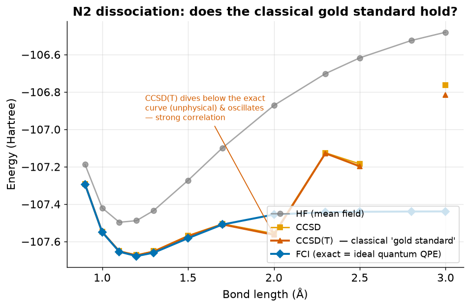
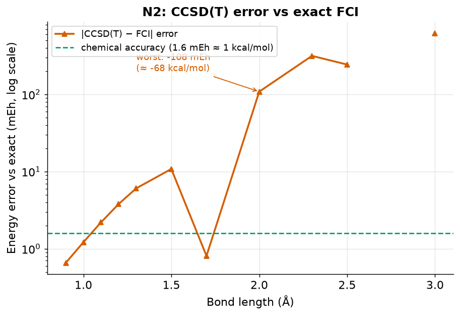

# Demo A — Quantum Chemistry: where the classical "gold standard" breaks

**One-line claim:** for strongly-correlated molecules, the best routine
classical method gives the *wrong* energy — and the error grows as the bond
stretches — while an ideal quantum computer running phase estimation would
return the exact answer, *provided* a good enough initial state can be prepared.

## Why this matters (industry)

Chemical reaction rates depend *exponentially* on energy: at room temperature a
**1 kcal/mol** error changes a predicted rate by about **5×**. These energies
feed catalysis, battery-material design (Ni/Co/Mn cathodes), combustion kinetics,
and semiconductor surface reactions. Industry mostly uses DFT, which is unreliable
exactly in the "strongly-correlated" cases that matter most — so companies fall
back on slow, expensive trial-and-error experiments.

## What the demo does

We stretch the bond of the nitrogen molecule (N₂) and compute its energy four
ways, from crude to exact:

| method | what it is |
|---|---|
| HF | mean-field (electrons move independently) |
| CCSD | coupled cluster (singles + doubles) |
| **CCSD(T)** | CCSD + triples — the classical **"gold standard"** |
| **FCI** | full configuration interaction = the **exact** answer in this basis; equals what an ideal **Quantum Phase Estimation** would return |

Everything in Part 1 is computed classically with PySCF (`run.py`). No quantum
circuit is run — the quantum-advantage point is a *scaling* argument (below).
Part 2 (`run_sqd.py`) runs an actual quantum circuit on the IonQ cloud
simulator (ideal, and with the `aria-1` hardware noise model) — not on a QPU.

## Result



Near the normal bond length all methods agree. As the bond stretches, the
electrons become **strongly correlated** and CCSD(T) — the gold standard —
peels away from the exact FCI curve, even dropping *below* it and oscillating.
That is an **unphysical result**: CCSD(T) is not variational, so its value
*can* fall below the exact energy — and when it does, that signals the method
has broken down.



The error grows from ~2 mEh near equilibrium to ~11 mEh at 1.5 Å, and at 2.0 Å
CCSD(T) is **~108 mEh (≈68 kcal/mol) below** the exact energy — far past the
1.6 mEh "chemical accuracy" line. (The small +0.8 mEh at 1.7 Å is not a
recovery: the signed error is crossing from positive to negative between 1.5 Å
and 2.0 Å and happens to pass near zero there.)

> **Convergence caveat.** Beyond ~2.3 Å the CCSD iterations themselves **do
> not converge** (PySCF reports `converged=False`), so the CCSD(T) values there
> (hundreds of mEh off) change from run to run and can even be NaN. `run.py`
> flags these points (`[CCSD not converged]`, column `ccsd_converged`,
> `summary.ccsd_unconverged_R`). Failing to converge is itself a symptom of the
> breakdown, but only the converged points (≤ 2.0 Å) give reproducible error
> values. FCI is reproducible everywhere.

## What it means

- FCI is exact here but its cost grows **exponentially** with molecule size, so
  for large molecules there is **no exact classical fallback**.
- An ideal fault-tolerant quantum computer runs Quantum Phase Estimation, whose
  cost is **polynomial** in system size *per run* — but it returns the ground
  energy only with probability equal to the **squared overlap** |⟨ψ₀|ψ_init⟩|²
  of the prepared initial state with the true ground state. For large strongly-correlated molecules
  that overlap may shrink rapidly with size, and no generic method is known to
  prepare a good initial state efficiently. The advantage therefore holds
  **provided a sufficiently good initial state can be prepared** (Lee et al.,
  *Nat. Commun.* 14, 1952 (2023)).
- The *failure pattern* of CCSD(T) shown here on a tiny molecule is the same
  kind of strong correlation found in real catalysts and battery cathodes.

## What this does NOT prove (honest limits)

- This small case is also handled well by specialized classical strong-
  correlation methods (**DMRG, CASSCF/MRCI**). Systems where no classical
  method suffices are expected to need **tens of active orbitals** — e.g. the
  FeMoco model used in quantum resource estimates has 54 orbitals (Reiher et
  al., *PNAS* 114, 7555 (2017)), later models larger — and where exactly the
  crossover lies is debated (Lee et al. 2023).
- **STO-3G is a minimal basis.** The numbers are a **method comparison within
  the same basis, not agreement with experiment**; absolute energies are far
  from experimental values.
- We did not run a fault-tolerant quantum computer; FCI stands in for the
  ideal QPE result.
- Whether a given industrial problem is truly in the "no classical method works"
  regime (vs. limited by solvent/temperature/structure uncertainty) must be
  checked case by case.

## Other molecules

`run.py -m <name>` runs the same comparison for other closed-shell molecules
(results in `results/<name>/`, figures in `figures/<name>/`). STO-3G results:

| molecule | qubits | worst CCSD(T) error | reading |
|---|---:|---|---|
| H₂ | 4 | 0 | 2 electrons: CCSD is exact (control) |
| LiH | 12 | 0.1 mEh | single bond, CCSD(T) holds |
| F₂ | 20 | 0.5 mEh | single bond, CCSD(T) holds |
| H₂O | 14 | −24 mEh at 2.1 Å; +98 mEh at 2.5 Å* | two bonds broken at once → breaks down |
| N₂ | 20 | −108 mEh at 2.0 Å | triple bond → strongest breakdown |

\* At H₂O 2.5 Å CCSD is borderline: the error is reproducible (+98.0 mEh) but
PySCF's `converged` flag flips between runs at its tolerance, so `run.py`'s
"worst" (converged points only) reports either +98 at 2.5 Å or −24 at 2.1 Å.

## Part 2 — SQD: using quantum samples instead of the full space (`run_sqd.py`)

FCI diagonalizes in the *full* configuration space, which grows exponentially.
**Sample-based Quantum Diagonalization (SQD)** runs a short LUCJ circuit (built
from CCSD amplitudes; MP2 when CCSD does not converge), samples bitstrings
(= electron configurations), repairs them ("configuration recovery") and
diagonalizes only in the small subspace they span.

N₂ / STO-3G = **20 qubits**, within the IonQ cloud simulator limit (25). The
LUCJ circuit transpiled for IonQ has depth 85 and ~400 two-qubit gates.

### IonQ results (2,000 shots, subspace ≤ 900 of 14,400 determinants)

Error vs exact FCI, in mEh:

| R (Å) | IonQ noisy sim (`aria-1`) | IonQ ideal sim | random bitstrings (control) | CCSD(T) |
|---:|---:|---:|---:|---:|
| 1.1 | +12.6 (dim 900) | +23.6 (dim 81) | +19.2 (dim 900) | +2.2 |
| 1.5 | +9.9 (dim 900) | +18.5 (dim 289) | +25.1 (dim 900) | +10.8 |
| 2.0 | +9.5 (dim 900) | +21.9 (dim 225) | +56.0 (dim 900) | **−108.5** |
| 2.5 | +3.6 (dim 900) | +6.5 (dim 196) | +4.7 (dim 900) | ~+240…+390 (CCSD unconverged) |

How to read it:
- **SQD vs CCSD(T):** near equilibrium CCSD(T) is better. In the strongly
  correlated region SQD stays within ~4–24 mEh using ≤ 6.25% of the space and —
  being variational — never drops below the exact energy, while CCSD(T) breaks
  down. SQD is still outside chemical accuracy (1.6 mEh) at this subspace size.
- **Compare at equal subspace size.** Ideal samples concentrate on few
  configurations, so their subspace stays small (81–289); noise spreads the
  samples and fills the 900 cap. The noisy column looks better *because its
  subspace is larger*, not because noise helps the circuit.
- **Random control.** At the same size (900), uniform random bitstrings with no
  circuit at all are clearly worse than the circuit's samples up to 2.0 Å
  (+56 vs +9.5 mEh at 2.0 Å) — the circuit does carry information. At 2.5 Å the
  gap nearly closes.
- Noisy runs vary by a few mEh from run to run (shot noise; an earlier
  `ionq_noise` run gave +9.4 mEh at 1.1 Å).

### Reference: IBM hardware samples

The qiskit-community NTU 2026 workshop
(`2026-ntu-scaling-for-quantum-advantage-and-beyond`, Apache-2.0), from which
the SQD workflow is adapted, provides 10,000 real shots from IBM's `ibm_fez`
for R = 1.1 Å (`data/n2_ibm_fez_samples.npz`, converted from the workshop's
pickle file to a pickle-free format). Equal-subspace comparison at R = 1.1 Å:

| samples | subspace | SQD − FCI |
|---|---:|---:|
| Aer, noiseless (10k shots) | 225 | +19.1 mEh |
| ibm_fez, real hardware (10k shots) | 225 | +27.4 mEh |
| random bitstrings | 225 | +89.7 mEh |
| ibm_fez, real hardware | 900 | +11.8 mEh |

At equal size the hardware samples are *worse* than noiseless ones (+27.4 vs
+19.1 mEh); the 900 row looks better only because its subspace is 4× larger.

Honest limits: on a system this small, classical selected-CI picks an equally
good subspace without any quantum computer; whether quantum sampling beats
classical selection at scale is an open, debated question.

## Run

```bash
python run.py                 # N2 -> results/energies.csv, results/summary.json
python run.py -m h2o          # other molecules: n2, f2, h2, lih, h2o
python plot.py [-m h2o]       # -> figures/[h2o/]dissociation.png, error.png

# IonQ key: put IONQ_API_KEY in the repo-root .env (see .env.example)
python run_sqd.py --backend ionq_noise --shots 2000   # IonQ noisy simulator
python run_sqd.py --backend ionq_sim   --shots 2000   # IonQ ideal simulator
python run_sqd.py --backend random     --shots 2000   # control: no circuit
python run_sqd.py                                     # local Aer (CPU)
python run_sqd.py --backend ibm_fez_cached [--max-dim 15]   # IBM reference samples
```
Results go to `results/sqd/sqd_<backend>[_dim<N>].csv`.
