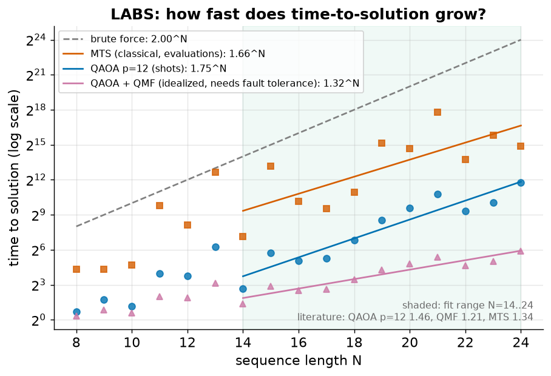
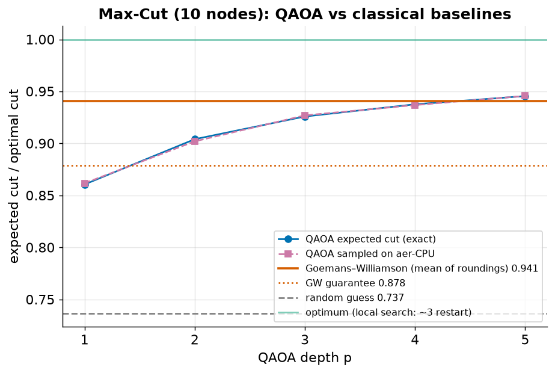

# Demo E — LABS: an optimization problem with a published quantum scaling claim

**One-line claim (tested, small scale):** for the LABS problem, the literature
reports that QAOA combined with quantum minimum finding scales better than the
best classical heuristic. We measure the same scaling exponents on our own
machine — and show how fragile they are at small N.

## The problem

Find a sequence of N signs s ∈ {+1, −1}ᴺ whose shifted copies overlap as little
as possible:

E(s) = Σₖ Cₖ²,  Cₖ = Σᵢ sᵢ sᵢ₊ₖ  (k = 1 … N−1)

Low-autocorrelation sequences are used for **radar / sonar pulse compression**
and communications. The problem is classically hard: the best heuristic,
Memetic Tabu Search (MTS), needs time ≈ 1.34ᴺ; exact optima are known only up
to N ≈ 66.

## Why this problem (vs. Max-Cut)

- It has a **published scaling-advantage claim**: Shaydulin et al.,
  *Sci. Adv.* 10, eadm6761 (2024), simulated QAOA up to N = 40:
  QAOA (p = 12) ≈ **1.46ᴺ**, QAOA + quantum minimum finding ≈ **1.21ᴺ**,
  classical MTS ≈ **1.34ᴺ**.
- Max-Cut has a classical approximation guarantee (Goemans–Williamson, 0.878)
  and excellent heuristics; there is no comparable advantage claim.

## What the demo does

| method | how TTS is measured |
|---|---|
| QAOA (p layers) | exact statevector simulation (own numpy simulator; the cost is diagonal). Linear-ramp schedule, 2 parameters tuned on N = 8–12 and **transferred unchanged** to larger N. TTS = 1 / P(optimum) shots |
| QAOA + QMF | idealized amplitude amplification on top: TTS = 1 / √P. Needs fault-tolerant hardware |
| MTS | our implementation of memetic tabu search; TTS = energy evaluations until the optimum is first hit (median of 20 runs) |
| brute force | 2ᴺ |

Only **exponents** are comparable — shots and classical evaluations are
different units. Correctness checks: the Ising expansion reproduces the
brute-force energies, the numpy simulator matches Qiskit's `Statevector`
(max diff 4e-17), and the minimal energies match the known LABS optima.

The same QAOA circuit is built in Qiskit (`PauliEvolutionGate` of the 2- and
4-body Z terms) and sampled on a `common/backend.py` target (Aer or IonQ) at
small N as a cross-check.

## Result (p = 12, N = 8–24, fit N = 14–24)



| method | ours | literature |
|---|---:|---:|
| QAOA p = 12 | 1.75ᴺ | 1.46ᴺ |
| QAOA + QMF | 1.32ᴺ | 1.21ᴺ |
| MTS | 1.66ᴺ | 1.34ᴺ |
| branch-and-bound (Gurobi, TTS) | — | 1.62ᴺ |
| brute force | 2ᴺ | 2ᴺ |

Circuit cross-check, N = 8, p = 12 (exact P(opt) = 0.614; random guessing = 0.0625):

| backend | shots | P(opt) sampled |
|---|---:|---:|
| Aer (local) | 4000 | 0.616 |
| IonQ ideal simulator | 1000 | 0.620 |
| IonQ noisy simulator (`aria-1`) | 1000 | **0.066** |

The circuit is already depth 675 with 783 two-qubit gates at N = 8 (Aer basis;
IonQ receives the Pauli rotations natively). Under a realistic noise model the
QAOA advantage over random guessing **disappears entirely** — LABS QAOA at
useful depth needs error-corrected hardware.

Reading:
- Same **ordering** as the literature: QAOA + QMF has the smallest exponent.
  QAOA alone is not better than the classical heuristic.
- But our QAOA + QMF (**1.32ᴺ**) is essentially **tied with the published MTS
  (1.34ᴺ)**; it only looks better than *our* weaker MTS. At this N range it is
  not evidence of an advantage on its own.
- In the paper, QAOA alone (1.46ᴺ) is compared with **branch-and-bound**, not
  with MTS: Gurobi's time-to-solution scales as **1.62ᴺ** (the Packebusch–Mertens
  exact solver's time to *prove* optimality is 1.73ᴺ). QAOA alone beats exact
  solvers, not the best heuristic.
- Our absolute exponents are **worse** than published, for both sides: the
  2-parameter linear-ramp schedule is cruder than the paper's optimized fixed
  parameters, and our MTS is a basic version (population 20).
- The exponents are **fragile**: individual N values are unusually easy or
  hard (N = 14 is easy, N = 21 is hard), so the fitted base moves noticeably
  with the fit range. At p = 8, N = 8–20, fitting from N = 12 gave 1.57 / 1.25 / 1.55
  instead.

## Control: Max-Cut, the textbook QAOA problem (`maxcut_control.py`)

Max-Cut is the standard first QAOA example — the cost has only 2-qubit ZZ terms,
so circuits are shallow — which makes it a good QAOA tutorial and a useful
**control**: classically it is the wrong place to look for an advantage.
Goemans–Williamson (SDP relaxation + random-hyperplane rounding) *guarantees*
an expected cut ≥ 0.878 × optimum, and simple local search finds the optimum on
graphs like this almost immediately. There is no published QAOA advantage claim.

Erdős–Rényi graph, 10 nodes, 28 edges, optimal cut 19 (ratio = expected cut / optimum):

| p | QAOA exact | Aer, 4000 shots | IonQ noisy sim (`aria-1`), 1000 shots | 2q gates |
|---:|---:|---:|---:|---:|
| 1 | 0.861 | 0.862 | 0.851 | 28 |
| 2 | 0.904 | 0.902 | — | 56 |
| 3 | 0.926 | 0.927 | 0.880 | 84 |
| 4 | 0.938 | 0.937 | — | 112 |
| 5 | 0.946 | 0.946 | 0.854 | 140 |

Classical baselines on the same graph: random guess 0.737; Goemans–Williamson
mean of roundings **0.941** (guarantee 0.878; 25% of roundings hit the optimum);
greedy local search reaches the optimum after a median of **3** random restarts.



Reading:
- QAOA needs depth **p = 5** just to match Goemans–Williamson's average, which
  a laptop computes instantly, and local search finds the exact optimum anyway.
- Under realistic noise, deeper is **not** better: p = 5 drops from 0.946 to
  0.854, about the same as p = 1. The noise added by each layer outweighs the
  gain from more layers.
- Contrast with LABS: Max-Cut circuits are shallow enough to survive noise
  partially, but there is no classical gap to exploit; LABS has the gap
  (no approximation guarantee, a published scaling claim), but its circuits are
  so deep that noise erases the result entirely (P(opt) 0.066 vs random 0.0625).

## What this does NOT prove (honest limits)

- Exponents fitted on N ≤ 24 do not establish asymptotic behaviour.
- The QMF speedup assumes **fault-tolerant** hardware; it is not available today.
- The LABS Hamiltonian has O(N³) four-body terms → deep circuits; on noisy
  hardware only very small N is feasible (IonQ's all-to-all connectivity helps).
- Classical solvers keep improving (e.g. GPU-parallel tabu search).
- Tuning the QAOA schedule used knowledge of the optimum at small N (as in the
  literature); that tuning cost is not counted.

## Run

```bash
python run.py                                    # N=8..20, p=8  (~35 s on CPU)
python run.py --n-max 24 --p 12 --fit-from 14    # result above (~6 min)
python run.py --circuit-backend ionq_sim --circuit-n 8   # IonQ cloud (needs IONQ_API_KEY)
python plot.py                                   # -> figures/tts_scaling.png

python maxcut_control.py                         # Max-Cut control, Aer (~6 s)
python maxcut_control.py --backend ionq_noise --sample-ps 1,3,5 --shots 1000
```
IonQ runs need `IONQ_API_KEY` in the repo-root `.env` (see `.env.example`).
