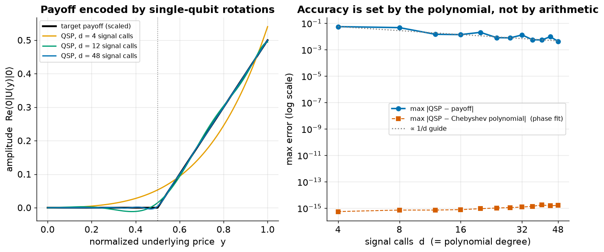

# Demo F — Quantum Signal Processing: encoding a payoff without quantum arithmetic

**One-line claim (mechanism, not advantage):** with Quantum Signal Processing
(QSP), an option payoff can be written into a quantum amplitude using only a
sequence of single-qubit rotations — no adders, multipliers or comparators —
and the accuracy is set by a polynomial degree we choose.

## Why this matters (industry)

Demo B showed that amplitude estimation needs ~1/ε queries instead of ~1/ε² —
but also that one query is a deep, expensive circuit. A large part of that cost
in earlier derivative-pricing resource estimates was **quantum arithmetic**:
computing the payoff (e.g. max(S − K, 0)) with reversible circuits, which needs
many ancilla qubits and T-gates. Stamatopoulos et al., *Quantum* 8, 1322 (2024)
replace that arithmetic with QSP and report **~4× fewer logical qubits, ~16×
fewer T-gates and a ~5× lower required logical clock rate**. This demo shows
the mechanism behind that saving on a small, checkable example.

## How QSP works (in one paragraph)

Put the signal x into a rotation W(x) = exp(iθX) with x = cos θ. Repeating it d
times gives amplitude cos(dθ) = T_d(x), the Chebyshev polynomial — so the
Chebyshev basis is *built into* the circuit. Interleaving d + 1 phase rotations
e^{iφZ} mixes these into any (bounded, fixed-parity) polynomial P(x) of degree
d. The recipe is therefore: approximate the payoff by a Chebyshev series
(classical), convert its coefficients into the d + 1 phases (classical "phase
finding"), and run d signal calls with the phases in between (quantum).

## What the demo does

- Target: call payoff on a normalized price y ∈ [0, 1], strike K = 0.5, scaled
  to |g| ≤ 0.5: g(y) = 0.5 · max(y − K, 0) / (1 − K). QSP polynomials have a
  definite parity, so we use the even extension f(x) = g(|x|).
- For d = 4, 8, …, 48: Chebyshev interpolant of f, then optimization-based phase
  finding (Dong–Meng–Whaley–Lin style, symmetric phases) so that
  Re⟨0|U_φ(x)|0⟩ reproduces it.
- Cross-check: the same phases built as a 1-qubit Qiskit circuit (RZ/RX) give
  the same amplitude (`Operator`), max difference ~1e-14.

Pure numpy/scipy (Qiskit only for the cross-check); runs in about a second.

## Result



| d (signal calls) | single-qubit rotations | max \|QSP − payoff\| | max \|QSP − Chebyshev\| |
|---:|---:|---:|---:|
| 4 | 9 | 0.055 | 6e-16 |
| 12 | 25 | 0.015 | 7e-16 |
| 24 | 49 | 0.008 | 1e-15 |
| 48 | 97 | 0.004 | 2e-15 |

Reading:
- The phase fit is exact to machine precision: **all remaining error comes from
  the polynomial approximation**, not from the quantum encoding.
- Because the payoff has a kink at the strike, the error falls roughly as
  **1/d** (fitted exponent ≈ −0.97). It wiggles from one d to the next because
  the interpolation nodes land differently relative to the kink; smoother
  payoffs converge much faster.
- Cost grows **linearly** in d (d signal calls, 2d + 1 rotations, one extra
  qubit), with no arithmetic registers.

## What this does NOT prove (honest limits)

- **Mechanism only.** The literature saving is a *constant factor* (~16× fewer
  T-gates), not an exponential speedup. Advantage for derivative pricing still
  needs ~4.7k logical qubits running ~10⁹ T-gates at a 45 MHz logical clock
  (Stamatopoulos et al. 2024) — far beyond projected error-corrected hardware.
- Here the signal is an explicit 1-qubit rotation. In a real pricer it is a
  **block-encoding of the price register**, whose cost we do not model.
- We do not count T-gates or compare against an arithmetic implementation; the
  resource numbers above are quoted from the paper.
- Phase finding is a classical preprocessing step; it gets harder (numerically)
  at very high degree.

## Run

```bash
python run.py    # -> results/qsp.csv, results/summary.json
python plot.py   # -> figures/qsp_payoff.png
```
