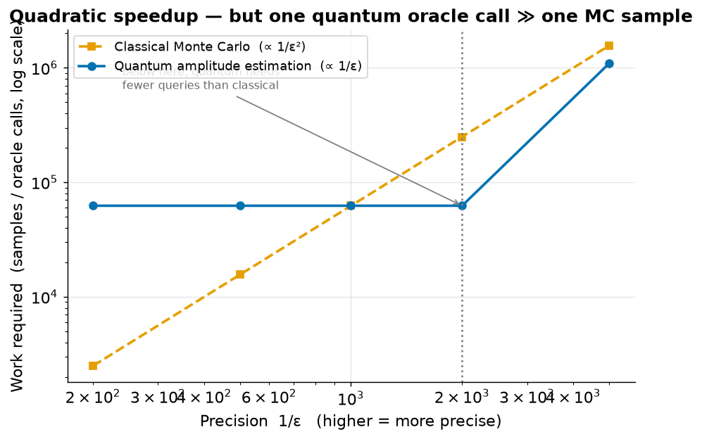
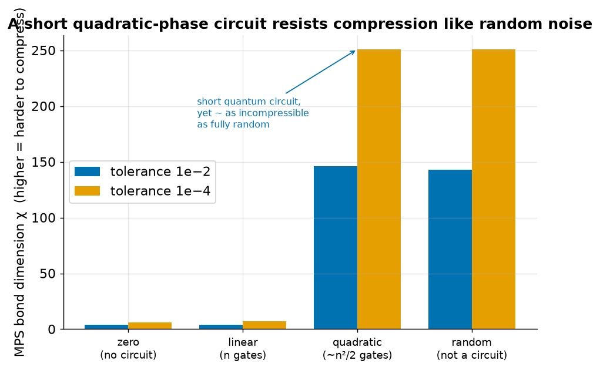
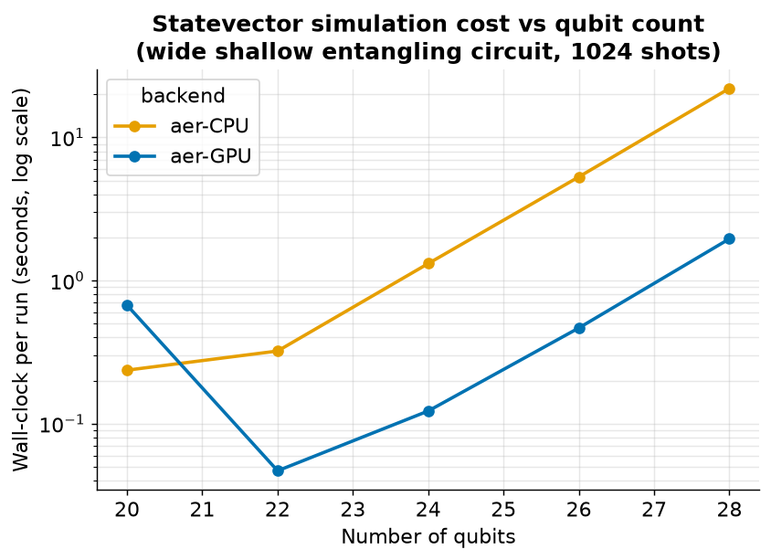

# Practical Quantum Advantage — a short, honest report

*For a non-specialist reader. Every number below comes from code in this
repository that you can re-run.*

## The question

"Quantum computing" is easy to hype and hard to pin down. The useful question for
a business is narrow: **where, concretely, does a quantum computer do something a
classical computer cannot do well — and where does it not (yet)?**

One caveat up front: you cannot prove a quantum *advantage* by running a quantum
*simulator*, because a simulator is just a classical computer imitating a quantum
one. So these demos do two honest things: show the principle on a small problem
you can check, and show *why the classical approach breaks at large scale*.

We look at three areas, in decreasing order of how strong the case is.

---

## 1. Chemistry — the clearest case

Chemical reaction rates depend *exponentially* on energy: a 1 kcal/mol error
changes a predicted rate by ~5×. That accuracy drives catalysts, battery
materials, combustion, and semiconductor processes — a real industrial
bottleneck.

We stretch a nitrogen molecule and compute its energy with methods from crude to
exact. The best *routine* classical method, "CCSD(T)" (chemists call it the gold
standard), is accurate near the normal bond length — then falls apart as the bond
stretches and the electrons become "strongly correlated":

The blue curve (FCI) is the exact answer — and is exactly what an ideal quantum
computer would compute. The red curve (the classical gold standard) tracks it,
then peels away, even dropping below the exact energy (physically impossible) and
oscillating. The error grows to **hundreds of kcal/mol**:

**Why it matters:** the exact method (FCI) becomes impossible for large molecules
— its cost explodes exponentially. A fault-tolerant quantum computer can deliver
that exact-quality answer at manageable cost. The failure we see on a toy
molecule is the same one that hits real catalysts and battery cathodes.

**Honest limit:** this particular small case is also handled by specialized
classical methods (DMRG, CASSCF). The real crossover — where *no* classical
method works — is estimated around 50-orbital active spaces. The value is in
showing the *pattern* and where it leads.

---

## 2. Finance — a real speedup, honestly not enough yet

Banks and insurers compute the probability of rare, large losses (the "tail") to
set regulatory capital, using heavy daily Monte Carlo runs. Quantum Amplitude
Estimation can, in principle, reach a target precision ε with far fewer queries:
**~1/ε** vs classical Monte Carlo's **~1/ε²**.

We estimate a tail probability on a 4-qubit model and count the work each side
needs:

The quantum curve (blue) rises much more slowly than the classical one (orange);
they cross near ε ≈ 0.001. The quadratic speedup is real.

**Honest limit — and this is the important part:** "fewer queries" is not "faster."
One quantum query is a deep circuit that, on error-corrected hardware with a slow
logical clock, is *millions of times slower* than one classical sample. So the
real crossover is pushed to much smaller ε or much larger problems — and classical
Monte Carlo has its own tricks (importance sampling). This is the honest reason
finance is **not** the first place to expect a quantum payoff. Being clear about
that is what makes the chemistry case believable.

---

## 3. Turbulence — a concept, not yet an advantage

Turbulence governs aircraft drag, engine combustion, and reactor mixing, and is
classically intractable to resolve directly at real scale. A quantum computer
stores 2ⁿ grid values in n qubits, raising hope for representing flow fields
beyond classical reach.

We build a turbulence-like 1D field and measure how hard it is to compress
classically (its "bond dimension" χ):

A field made by a **short** quantum circuit (quadratic phases, ~120 gates)
resists compression almost as strongly as fully random data. So a short circuit
*can* represent something classical compression cannot.

**Honest limit:** representability is not an application advantage. Evolving the
physics and reading out useful numbers efficiently are unsolved. This is a concept
demo — it shows one necessary ingredient, nothing more.

---

## 4. Tooling — where the GPU and the cloud fit

A practical aside, not a quantum claim. Simulating a quantum computer is a
classical job, and it gets expensive fast: a statevector holds 2ⁿ numbers. We
timed one wide, shallow circuit at growing qubit counts on a CPU, on a GPU, and
on IonQ's cloud simulator:

The GPU is *slower* on tiny circuits (overhead) and crosses over near 22 qubits,
then runs ~11× faster — so GPUs matter only once the statevector is large. The
same circuit also runs unchanged on IonQ's cloud, one step from real hardware.

**Honest limit:** this is classical-simulation engineering, not a quantum
advantage; and cloud timings include network/queue latency, so they show
portability, not speed. Past ~32 qubits, even four pooled GPUs (96 GB) cannot
hold the statevector — which is exactly why large quantum circuits cannot be
checked by classical simulation.

---

## Bottom line

| Area | Verdict |
|---|---|
| **Chemistry** | Strongest. A clear accuracy advantage where the best classical method provably fails; a scaled-down version of a real bottleneck. |
| **Finance** | A genuine quadratic speedup, but not yet sufficient — the honest reason it is not the first priority. |
| **Turbulence** | A concept. Shows a necessary condition for quantum CFD; the application case is unproven. |
| **Tooling** | Not a quantum advantage. Shows which classical hardware to simulate on, and that the demos run on a real vendor's cloud, not just locally. |

The through-line: **be specific, show the numbers, and state the limits.** That is
how a quantum program earns trust rather than hype.
